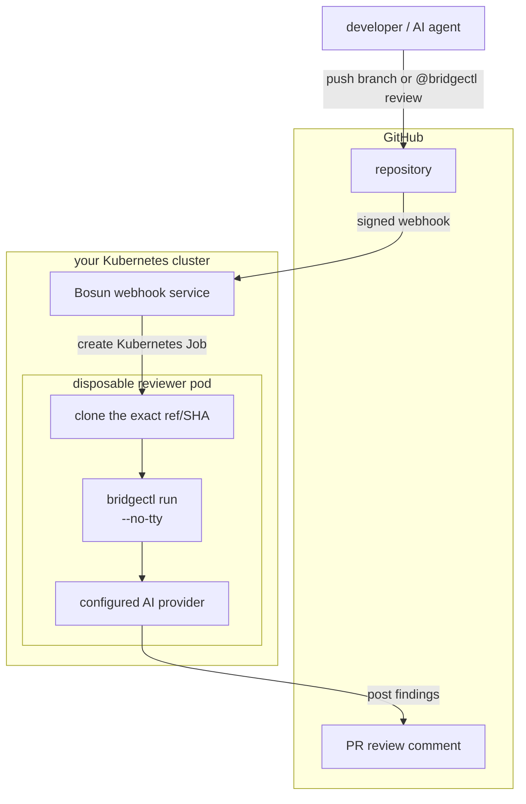
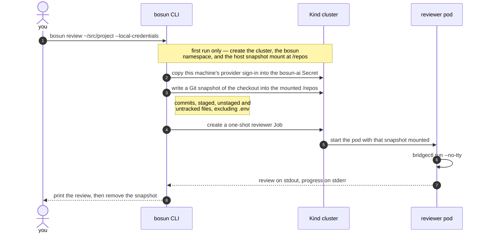

# Bosun

[](https://github.com/everydaydevopsio/bosun/actions/workflows/ci.yml)
[](https://github.com/everydaydevopsio/bosun/actions/workflows/publish.yml)
[](LICENSE)
[](https://github.com/everydaydevopsio/bosun/releases)

Bosun is an event-driven AI code-review controller built on [orchael/bridgectl](https://github.com/orchael/bridgectl).

It replaces the hosted-reviewer shape with infrastructure you control:



## Triggers

Bosun accepts branch creation, selected pull-request lifecycle events, and `@bridgectl review` comments on pull requests. A human, CI automation, or another AI agent can request a review without receiving the model credential.

Comment triggers are restricted to the author associations in `review.allowedAssociations` (`OWNER,MEMBER,COLLABORATOR` by default), and comments from bots are ignored so a review cannot trigger itself.

## Why bridgectl

Bosun is orchestration, not another agent runtime. The same review primitive runs locally through `scripts/review-local.sh` and remotely as a Kubernetes Job. Provider selection remains a bridgectl concern.

Bosun speaks bridgectl's gRPC `BridgeService` directly rather than shelling out: it starts a session, delivers the prompt with `WriteInput`, and ends the session with `StopSession`. See [docs/bridgectl.md](docs/bridgectl.md).

## Local development — no GitHub required

Bosun reviews any local Git checkout, including uncommitted changes, in a Kind
cluster it creates for you. With the released CLI and an authenticated `codex` or
`claude` on your machine, that is one command:

```bash
bosun review ~/src/project-to-review --local-credentials
```

The first run creates the Kind cluster, creates the namespace, copies this
machine's provider sign-in into the cluster's `bosun-ai` Secret, and runs the
review. Later runs reuse all of it. `bosun down` removes the cluster and its
snapshots; `bosun up --local-credentials` prepares a cluster ahead of time or
refreshes credentials after you re-authenticate.

What that one command does, end to end:



Nothing leaves your machine except the prompt and diff your chosen AI provider
receives. The reviewed repository never needs to exist on GitHub.

`--local-credentials` looks for an already-exported variable
(`OPENAI_API_KEY`, `CODEX_AUTH`, `CLAUDE_CODE_OAUTH_TOKEN`, `ANTHROPIC_API_KEY`,
`CLAUDE_CREDENTIALS`, `GEMINI_API_KEY`), then `codex`'s `auth.json`, then
`claude`'s credentials — from the macOS Keychain, or `~/.claude/.credentials.json`
elsewhere. Only the selected provider's credentials are mounted into the reviewer
Job. Without the flag, nothing is copied and the cluster uses whatever Secret is
already there.

Working from a source checkout instead, where the reviewer image is built locally:

```bash
make setup
make kind-up    # builds bosun:dev, loads it, and installs the chart
make cli
./bin/bosun review ~/src/project-to-review --provider codex-bosun
```

Use `make install` to install the `bosun` command on your Go binary path. Review
another branch with `bosun review "$PWD" --branch feature/name --base main`.
The CLI shows progress, elapsed time, errors, and history-based duration estimates.
`make review REPO=...` remains a compatibility entrypoint.

The result is printed to the terminal. The reviewed repository does not need to exist on GitHub. See [docs/local-development.md](docs/local-development.md).

Use `codex-bosun` or `claude-bosun`. The packaged `codex` provider runs Codex's
interactive TUI, so its output is screen repaints and Bosun rejects it rather
than post that to a pull request; `codex-bosun` runs `codex exec` headless
instead. See [docs/bridgectl.md](docs/bridgectl.md#choosing-a-provider).

## Install

### CLI (macOS and Linux)

```bash
brew install everydaydevopsio/bosun/bosun
bosun version
```

`bosun init` installs the matching review skill for configured coding agents.
`bosun doctor` reports local Kind and skill health; `bosun reset` recreates a
stale Kind cluster while retaining review snapshots. See
[local development](docs/local-development.md#start-the-environment) for flags
and recovery steps.

macOS builds are signed with a Developer ID certificate and notarized by Apple, so
they run without a Gatekeeper prompt. Windows binaries are not published yet.

Or download a release archive from the
[releases page](https://github.com/everydaydevopsio/bosun/releases) and verify it
against `checksums.txt`. To build from source:

```bash
make cli    # ./bin/bosun, version-stamped from git describe
make install
```

### Update the CLI (macOS and Linux)

Bosun is distributed as a Homebrew cask, so the same two commands update it on
either platform:

```bash
brew update                   # refresh the everydaydevopsio/bosun tap
brew upgrade --cask bosun
bosun version                 # confirm the new version
```

`brew update` is the step that matters. `brew upgrade` compares the installed
version against the tap clone on your machine, so a stale clone reports nothing
to do even when a newer release exists — which is what you see if
`HOMEBREW_NO_AUTO_UPDATE=1` is set in your environment. Check what your clone
currently offers with:

```bash
brew info everydaydevopsio/bosun/bosun
```

If that version trails the
[latest release](https://github.com/everydaydevopsio/bosun/releases), run
`brew update` and try again.

After upgrading, reinstall the review skill so your coding agents pick up the
instructions that shipped with the new binary:

```bash
bosun init --force
```

Plain `bosun init` leaves an existing skill alone when it differs from the one
the binary ships, on the assumption the difference is a local edit, so an
upgrade needs `--force` to take effect.

Installs from a release archive or `make install` are not managed by Homebrew;
re-download or rebuild those. The controller is versioned and upgraded
separately — see [Controller (Kubernetes)](#controller-kubernetes).

### Controller (Kubernetes)

```bash
helm install bosun oci://ghcr.io/everydaydevopsio/charts/bosun --version <version>
```

Upgrade an existing install the same way, with the new chart version:

```bash
helm upgrade bosun oci://ghcr.io/everydaydevopsio/charts/bosun --version <version>
```

The chart's `image.tag` defaults to its `appVersion`, so it always pulls the image
it was released with. No `latest` tag is published — pin a version or a digest.
The CLI and the chart are released from the same tag but upgrade independently;
updating one does not update the other.

For an end-to-end path from nothing to reviews on your pull requests, including
what it costs each month:

- [docs/self-hosted-digitalocean.md](docs/self-hosted-digitalocean.md) — a
  single-node DigitalOcean cluster, $24–36/month plus model usage.
- [docs/self-hosted-local-tunnel.md](docs/self-hosted-local-tunnel.md) — Kind on
  your own machine behind a tunnel, free with Cloudflare Tunnel.

## Quick start

1. Build and publish this image, pinning the bridgectl version you run (see [docs/bridgectl.md](docs/bridgectl.md)).
2. Create the `bosun-webhook`, `bosun-github`, and `bosun-ai` Kubernetes Secrets.
3. Install `charts/bosun`.
4. Expose `/webhooks/github` over TLS.
5. Configure the GitHub webhook.
6. Comment `@bridgectl review` on a test PR as a repository owner, member, or collaborator.

See [docs/setup.md](docs/setup.md) for exact commands, permissions, Helm values, and security guidance.

## Operations

- `review.maxConcurrent` (default 3) caps simultaneous reviewer Jobs; a namespace-scoped Kubernetes Lease serializes admission across replicas, and further deliveries get a 503 when capacity is full.
- `review.timeoutSeconds` (default 1800) is the single timeout for a review; the Job deadline is derived from it.
- `logging.format` (`text` or `json`) and `logging.level` mirror bridgectl's slog setup.
- Production installs should use a GitHub App rather than a PAT — see [docs/github-app.md](docs/github-app.md).

## Current scope

PR reviews are posted as conversation comments. GitHub App installation tokens are supported, with a PAT fallback. Branch-created reviews remain in Job logs; Checks API output is not implemented yet.

## Releasing

Releases are cut from **Actions → Publish** with a `patch`/`minor`/`major` choice;
one tag produces the image, the chart, and the signed CLI archives. See
[docs/releasing.md](docs/releasing.md) for the required secrets and the recovery
procedure for a release that fails after tagging.

## License

MIT License - see [LICENSE](LICENSE) file for details.
